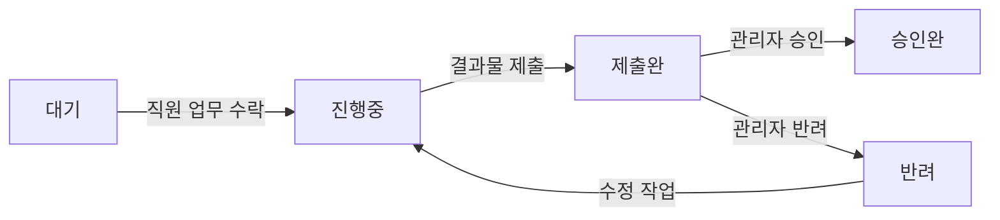

# 원격 근무용 업무 처리 확인 시스템

2026년도 모블 2차 팀 프로젝트

원격 근무 환경에서 업무 배정부터 결과물 제출, 관리자 검토와 이력 확인까지 하나의 흐름으로 관리하는 시스템입니다. 직원과 관리자가 업무 상태를 공유하고, 공지·채팅·협업 요청·출퇴근·연차 관리 기능을 함께 사용하는 것을 목표로 합니다.

현재는 요구사항과 기본 화면을 검토하는 단계입니다. 아래 주요 기능은 프로젝트의 설계 범위이며, 실제 인증·업무 처리·서버 및 장치 연동은 이후 구현합니다.

## 프로젝트 목적

- 담당 업무와 마감일, 현재 처리 상태를 직원과 관리자가 함께 확인합니다.
- 결과물과 재제출 버전을 보존하고 승인·반려 과정을 기록합니다.
- 업무 관련 소통과 공지, 출퇴근 및 연차 관리를 한 프로그램에서 제공합니다.

## 사용자와 역할

| 구분 | 역할 |
|---|---|
| 직원 | 배정된 업무 확인·수락, 검토 및 마감 연장 요청, 협업 요청, 결과물 제출·재제출, 공지·채팅 이용, 출퇴근·잔여 연차 확인 및 휴가 신청 |
| 관리자 | 업무 등록·배정·수정·취소, 직원 요청 확인, 결과물 승인·반려, 공지 작성·상단 고정, 업무 이력 조회, 직원 출퇴근 및 휴가 신청 검토 |

업무의 최종 승인과 휴가 신청의 승인·반려는 관리자가 담당하도록 설계합니다.

## 주요 기능

| 영역 | 기능 설계 |
|---|---|
| 로그인과 권한 | 아이디·비밀번호 및 지문 로그인, 직원·관리자 구분, 역할별 메뉴와 사용자 정보 표시 |
| 공지와 알림 | 대상별 공지 조회, 관리자 공지 작성, 상단 고정 공지와 직원 팝업, 마감 전날 알림과 변경된 마감일 기준 갱신 |
| 업무 관리 | 업무 등록·배정·수락, 상세 및 첨부파일 확인, 검토·마감 연장 요청과 관리자 확인 |
| 협업 | 업무 화면에서 다른 직원에게 협업 요청 |
| 결과물 | 결과 설명·파일 제출, 제출 시각과 버전 관리, 이전 제출물 보존 |
| 결과 검토 | 관리자 승인·반려 및 사유 작성, 직원의 검토 결과 확인과 재제출 |
| 채팅 | 개인·단체 대화와 업무 관련 파일 공유 |
| 업무 이력 | 관리자의 업무 생성·변경·제출·승인·반려 기록 조회 |
| 출퇴근과 연차 | 출퇴근 기록과 잔여 연차 확인, 연차·반차(오전/오후)·병가·공가 신청 및 관리자 승인·반려 |

### 기본 업무 흐름



직원은 업무 진행 중 검토나 마감 연장을 요청할 수 있습니다. 마감일 도래 시 자동 처리 방식과 결과물이 없는 업무의 처리 규칙은 추가 협의 대상입니다.

## 화면 구성

| 사용자 | 메뉴 순서 |
|---|---|
| 직원 | 공지 → 업무 → 채팅 → 결과물 → 출퇴근·연차 |
| 관리자 | 공지 → 업무 → 채팅 → 결과물 검토 → 업무 이력 → 출퇴근·연차 |

로그인 후 메인 화면에서 기능별 화면으로 이동합니다. 협업 요청은 업무 화면에 포함하고 채팅은 별도 메뉴로 구성합니다. 업무 등록, 결과물 제출, 요청 확인, 휴가 신청과 검토는 별도 창으로 엽니다.

클라이언트는 `LoginForm → MainForm → 기능별 UserControl` 구조를 사용합니다. 각 화면은 `.cs`, `.Designer.cs`, `.resx`로 나누어 Visual Studio의 디자이너와 도구상자에서 수정할 수 있도록 구성합니다.

## 기술 구성

| 구분 | 기술 | 적용 상태 |
|---|---|---|
| 데스크톱 클라이언트 | C#, WinForms, .NET 8 | 기본 화면 구성에 사용 |
| 서버 API | Python, Flask | 연동 예정 |
| 데이터베이스 | MySQL | 연동 예정 |
| 보조 웹 화면 | HTML, CSS | 설계 및 구현 예정 |
| 장치 연동 | Raspberry Pi, Python, 지문 센서·카메라·OLED | 연동 예정 |

클라이언트, 서버 API, 데이터베이스와 장치가 연동되는 구성을 목표로 합니다. 지문 인증과 출퇴근 기록, 장치 표시 등은 서버·클라이언트 구현과 함께 연결할 예정입니다.

## 개발 상태

현재 단계는 **기능 설계와 기본 화면 검토**입니다. 화면 초안에서는 역할별 메뉴 이동, 입력 항목 편집, 창 열기와 닫기를 확인합니다. 표와 상세 내용은 고정 예시 데이터입니다.

로그인·지문 인증, 업무 등록·수락·승인·반려, 메시지와 파일 전송, 공지 발행·팝업 전달, 연차 저장·검토는 구현 예정입니다. 기본 화면의 업무 버튼은 준비 중 안내를 표시하며 실제 데이터를 처리하지 않습니다.

## 개발 환경과 실행

WinForms 클라이언트 개발에는 다음 환경을 사용합니다.

- Windows
- .NET 8 SDK
- Visual Studio의 **.NET 데스크톱 개발** 워크로드

현재 `main`에는 프로젝트 소개 문서를 먼저 등록하고 있습니다. 실행 안내는 WinForms 소스가 포함된 브랜치에 적용하며, 해당 브랜치의 README에서 필요한 설정을 함께 확인합니다.

클라이언트 소스 루트에서 `RemoteWork.sln`을 열고 `RemoteWork.WinForms`를 시작 프로젝트로 지정합니다. 터미널에서는 다음 명령을 사용합니다.

```powershell
dotnet restore .\RemoteWork.sln
dotnet run --project .\RemoteWork.WinForms\RemoteWork.WinForms.csproj
```

기본 화면에서는 로그인 창의 **직원 화면** 또는 **관리자 화면**으로 화면 구성을 확인합니다. 실제 로그인과 업무 처리 기능은 구현 단계에서 연결합니다.

## 브랜치별 README 관리

`main`의 README는 프로젝트 전체의 목적, 기능과 공통 구성을 설명합니다. 작업 브랜치의 README는 해당 브랜치의 목적과 담당 범위, 구현 상태, 실행 환경·설정, 확인 방법에 맞춰 작성합니다.

계획된 기능과 구현된 기능을 구분하고, 실행 명령과 파일 경로는 해당 브랜치에 포함된 소스를 기준으로 관리합니다.
